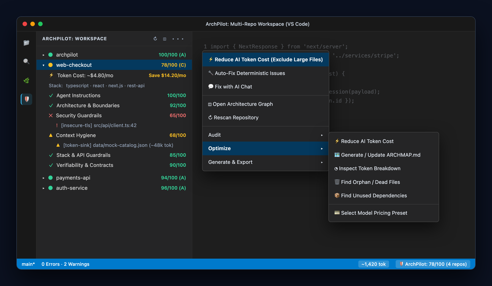
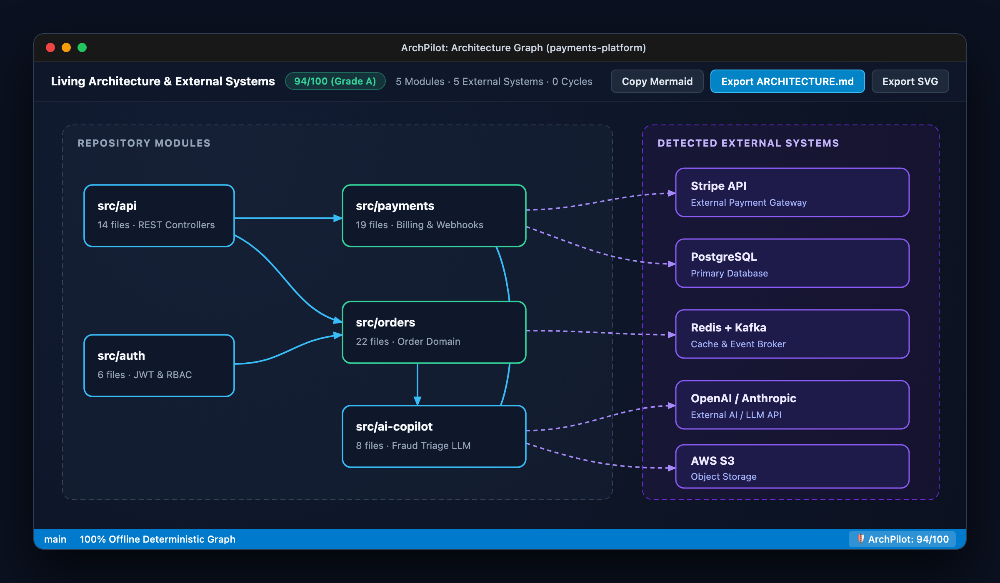
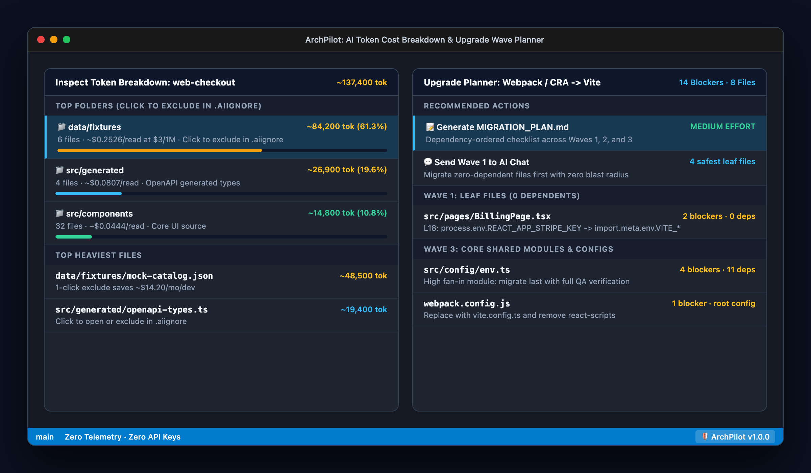
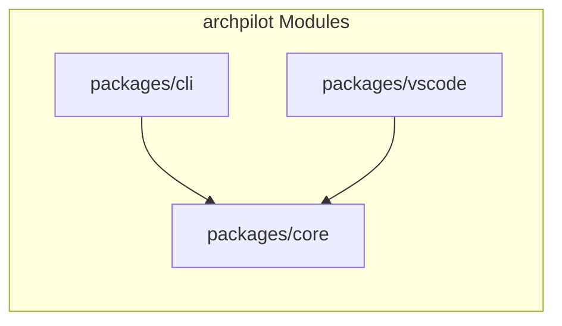

# ArchPilot

**Stop AI coding agents from burning tokens and rotting your architecture.**

[](https://marketplace.visualstudio.com/items?itemName=Pallattu.archpilot-studio)
[](https://github.com/jacob-git/archpilot/blob/main/LICENSE)
[](#privacy--enterprise-ready)
[](#what-archpilot-does)

Instant, **100% offline & deterministic** architecture guardrails, living diagrams, AI token-cost optimization, security & CVE auditing, and 1-click PR/QA handoff briefs: in **VS Code, Cursor, Windsurf, CLI, and any CI/CD**.

> **Zero API keys required. Zero telemetry. Works in air-gapped & MCP-restricted enterprises.**



---

## Try It in 10 Seconds

### VS Code / Cursor / Windsurf
Install **[ArchPilot on VS Code Marketplace](https://marketplace.visualstudio.com/items?itemName=Pallattu.archpilot-studio)** (`Pallattu.archpilot-studio`), open any workspace, and click the **ArchPilot shield icon** on the left Activity Bar.

### CLI & CI/CD (GitHub, GitLab, Bitbucket, Azure DevOps)
```bash
# Instant repo audit (score, stack, token cost, security, NFRs)
npx archpilot .

# Analyze git changes, downstream blast radius & QA test gaps
npx archpilot . --diff

# Generate ready-to-paste PR & QA Handoff Brief (Markdown + Mermaid)
npx archpilot . --pr-brief

# Output living Mermaid architecture diagram or write ARCHITECTURE.md
npx archpilot . --diagram
npx archpilot . --arch-md

# Audit dependency CVEs (auto-falls back to public npmjs.org if corporate registry lacks audit endpoint)
npx archpilot . --dep-audit

# Plan a dependency-ordered upgrade or migration (e.g. webpack-to-vite, spring-boot-3-to-4, cjs-to-esm)
npx archpilot . --migrate webpack-to-vite
npx archpilot . --migrate-md spring-boot-3-to-4

# Find unreachable/dead files wasting AI tokens, or diff against a saved architecture baseline
npx archpilot . --orphans
npx archpilot . --tokens
npx archpilot . --unused-deps
npx archpilot . --save-baseline
npx archpilot . --compare-baseline
npx archpilot . --api-diff

# Universal CI formats
npx archpilot . --fail-under 80 --format sarif > archpilot.sarif
npx archpilot . --format markdown
npx archpilot . --format html > archpilot-report.html
```

---

## What ArchPilot Does

| Pillar | What It Solves |
| :--- | :--- |
| **AI Token Cost Optimizer** | Measures always-on instruction overhead (`AGENTS.md`/`CLAUDE.md`/`.cursor/rules`), converts to monthly \$/dev using your live **Copilot / VS Code models**, shows an **Active File Token Counter** in the Status Bar, generates compact `ARCHMAP.md` repo maps, and excludes large token sinks in `.aiignore` & `.cursorignore` in 1 click. |
| **Upgrade & Migration Planner** | Offline readiness playbooks (**Webpack -> Vite**, **Spring Boot 3 -> 4**, **CommonJS -> ESM**, **React 18 -> 19**, **Pydantic v1 -> v2**) plus custom `archpilot.json` `migrations` guardrails. Orders impacted files into safe dependency waves (`MIGRATION_PLAN.md`) and hands Wave 1 straight to AI Chat. |
| **Living Architecture Diagrams** | Interactive VS Code graph of modules + auto-detected **External Systems** (PostgreSQL, Redis, Kafka, AWS, OpenAI/Anthropic/Gemini). 1-click **Copy Mermaid**, **Export `ARCHITECTURE.md`**, and **Export SVG**. |
| **1-Click PR & QA Handoff Brief** | Generates a ready-to-paste PR/MR/Jira brief with **Risk Badge**, **Mini Mermaid Impact Map**, **QA Regression Checklist** (tests to run + untested files), and **Security/Architecture Gate**. |
| **Security & CVE Guardrails** | Catches hardcoded secrets (AWS, GitHub, Stripe, Slack, OpenAI, Anthropic, Private Keys), exposed `.env`/`.key`, SQLi, command injection, XSS, disabled TLS, wildcard CORS, **poisoned AI instruction files** (hidden Unicode / `curl\|sh`), plus on-demand **Dependency CVE Audit** with 1-click `npm audit fix`. |
| **Architecture & Stack Packs** | 6-language import graph (**TS, JS, Java, Python, Go, Rust**), circular dependency detection, smart auto-generated `archpilot.json` boundaries, **Spectral-style OpenAPI/REST linting**, Spring Boot NFRs, Next.js `'use client'` leaks, FastAPI async checks, HTTP timeouts, and QA flaky-test detection. |

---

## Example: Living Architecture Graph & Token / Upgrade Planner







---

## CI/CD Integration (Any Git Host)

### GitHub Actions
```yaml
- uses: jacob-git/archpilot@v1.0.0
  with:
    fail-under: "80"
```

### GitLab CI (`.gitlab-ci.yml`)
```yaml
archpilot:
  image: node:22
  script:
    - npx --yes archpilot . --fail-under 80 --format sarif > archpilot.sarif
  artifacts:
    paths: [archpilot.sarif]
```

### Bitbucket Pipelines (`bitbucket-pipelines.yml`)
```yaml
pipelines:
  pull-requests:
    "**":
      - step:
          name: ArchPilot Guardrails
          image: node:22
          script:
            - npx --yes archpilot . --fail-under 80
```

### Opt-In MCP Server (For AI Coding Agents)
```json
{
  "mcpServers": {
    "archpilot": {
      "command": "npx",
      "args": ["-y", "archpilot", "mcp"]
    }
  }
}
```
Exposes `audit_repo`, `check_boundaries`, `check_diff`, `get_arch_map`, `get_architecture_diagram`, `generate_pr_brief`, and `get_fix_prompt`. *(100% optional: zero penalty in MCP-restricted environments.)*

---

## Privacy & Enterprise Ready

- **100% Local Core Analysis:** Zero telemetry, zero source code uploaded, zero API keys required.
- **Enterprise Registry Safe:** Dependency CVE auditing automatically falls back to `https://registry.npmjs.org` if an internal registry disables the audit endpoint (configurable via `archpilot.npmAuditRegistry`).

---

## Local Development

```bash
npm install
npm run build
npm run typecheck
npm run test
npm run audit:self
npm run package:vscode
```
